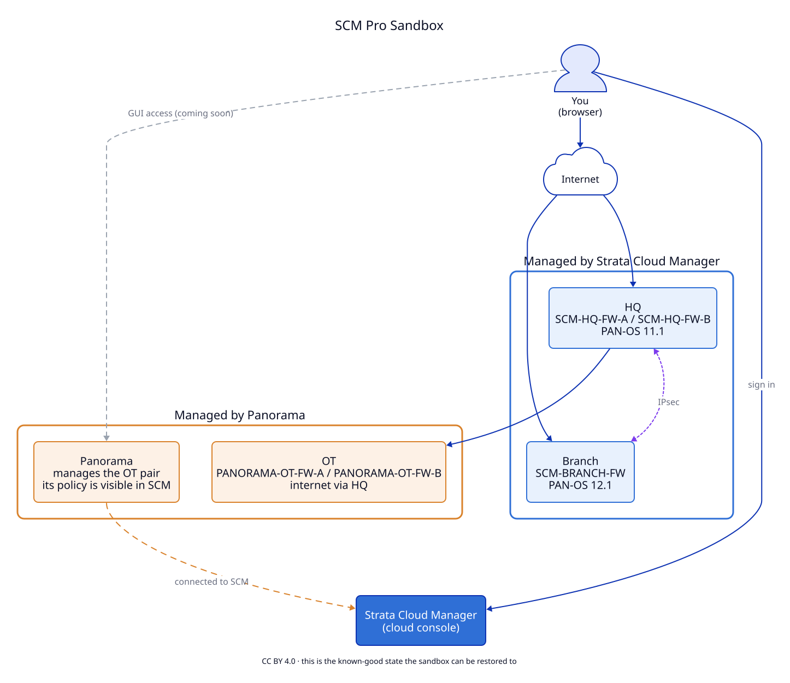
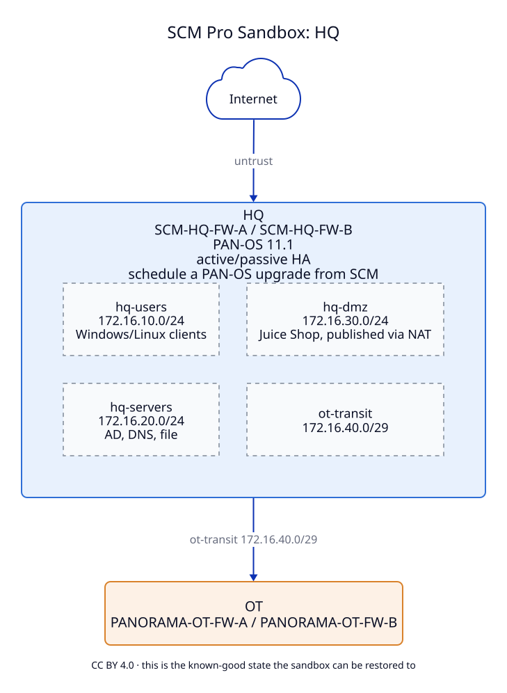
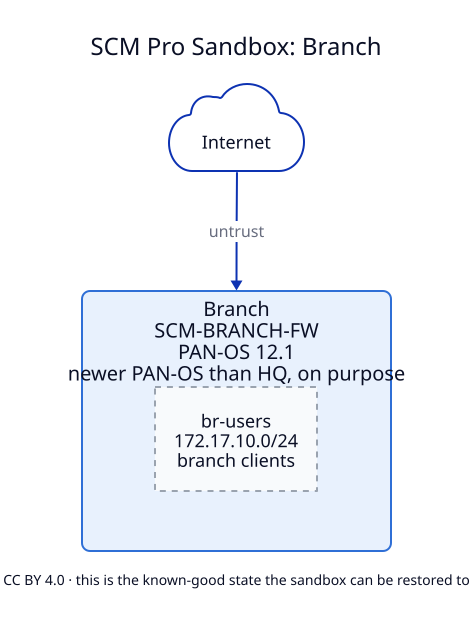
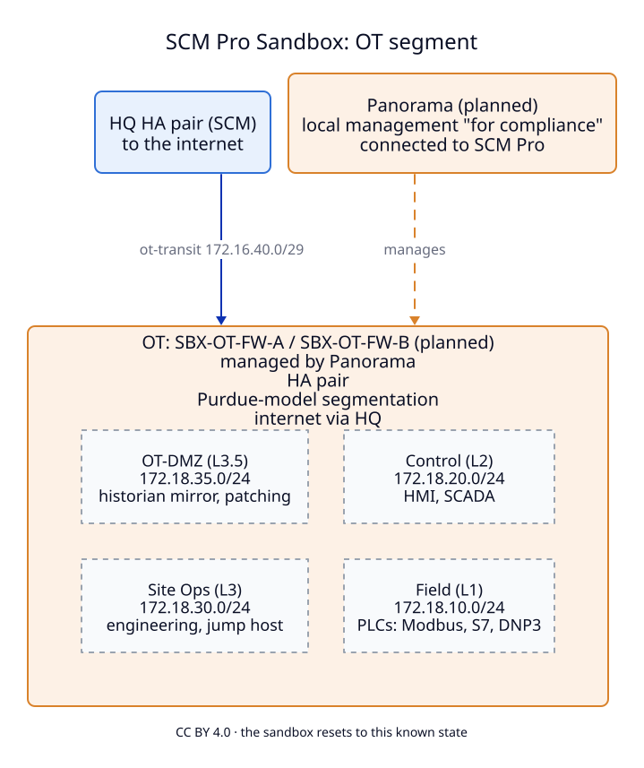

# SCM Pro Sandbox

Real Palo Alto Networks firewalls you can log into and change, managed two ways side by side:
**Strata Cloud Manager (SCM)** and **Panorama**. They have live traffic in them, so the logs,
dashboards and recommendations have something to show.

## What's in it

The firewall names tell you who manages them: **SCM-…** firewalls are managed by Strata Cloud Manager,
**PANORAMA-…** firewalls by Panorama.

| Site | Firewalls | Managed by | What's there |
|---|---|---|---|
| **HQ** | SCM-HQ-FW-A, SCM-HQ-FW-B (HA pair) | Strata Cloud Manager | users, servers, and a public web shop |
| **Branch** | SCM-BRANCH-FW | Strata Cloud Manager | users; VPN to HQ; a newer PAN-OS than HQ |
| **OT** | PANORAMA-OT-FW-A, PANORAMA-OT-FW-B (HA pair) | Panorama, connected to SCM | a factory-style network behind HQ |

Everything is VM-Series, with all security subscriptions on. Logs go to Strata Logging Service.

## How to get in

> [!IMPORTANT]
> **Not live yet.** This section describes how access will work. Until this note is gone, ask the person who
> shared this page with you.

You only need a web browser. There are two doors:

| To open | Go to | Sign in with |
|---|---|---|
| **Strata Cloud Manager** (HQ, Branch, and the Panorama view) | [stratacloudmanager.paloaltonetworks.com](https://stratacloudmanager.paloaltonetworks.com) | your own Palo Alto Networks account, once you've been invited to the sandbox tenant |
| **Panorama and the firewall web consoles** | `access.ngfwsandbox.com` *(placeholder)* | your **work email**: you get a one-time code, then the sandbox login |

To get access:

1. **Ask for an invite** *(process to be decided)*. Use your work email; personal addresses (Gmail, Outlook.com…) aren't accepted.
2. **Accept the SCM invite** from your inbox. The tenant is called *RyBelo - SCM Pro*.
3. **For Panorama or a firewall**, open `access.ngfwsandbox.com`, enter your work email, type the code you receive,
   and pick the device from the list.

Access is limited to a few countries and is logged. Invites expire after *(TBD)* days.

## Good to know

- **It resets.** The sandbox goes back to a known-good state regularly. Break things freely, but don't expect your
  changes to last.
- **It's shared.** Other people may be logged in. An upgrade or a push you start affects everyone.
- **Nothing real goes in.** No production data, passwords or customer configuration.
- **Panorama changes show up in SCM late.** SCM picks up Panorama's configuration on a schedule, not when you commit,
  so expect a delay of hours. Changes made in SCM itself show up right away.
- **The shop is meant to be hacked.** [shop.ngfwsandbox.com](https://shop.ngfwsandbox.com) runs OWASP Juice Shop, a
  deliberately vulnerable app. Attack it, and nothing else.
- **Your own firewall may block the shop.** ngfwsandbox.com was registered in October 2026, and URL filtering often
  blocks newly registered domains for about a month. If the shop won't load from work, try another network.
- **PAN-OS versions are deliberately not the latest,** so you can try an upgrade.

## Worth looking at

- **The two ways to manage firewalls** side by side: the HQ and Branch firewalls in SCM, and the OT firewalls in
  Panorama and in SCM's view of Panorama.
- **HA:** the HQ pair is active/passive and fails over when it loses its internet path.
- **Logs with something in them:** web browsing, SaaS and AI apps, file shares, VPN traffic, factory protocols (Modbus,
  S7, DNP3), plus test malware, phishing and DNS threats.
- **Decryption:** outbound web traffic is decrypted, so you see real application names and URLs. Banking, health and
  government sites are not decrypted.
- **Policy Optimizer and cleanup:** some rules and objects are unused on purpose, and some rules still allow
  *any* application, so the recommendations have something to say.
- **Attacks on the shop**, seen by the firewall between the shop's web proxy and its app server.

## Site detail

<b>HQ</b>: users, servers, web shop, and the way out for OT

<b>Branch</b>: users, VPN to HQ

<b>OT</b>: the Panorama-managed factory network

Click a drawing to open it full size. They're generated from the sandbox's own configuration with
[D2](https://d2lang.com).

## Runbook

[Connect Panorama to Strata Cloud Manager and Strata Logging Service](PANORAMA-TO-SCM.md): the two plugins, the steps,
and the gotchas the official docs leave out.

---

Drawings and documentation: [CC BY 4.0](LICENSE). Palo Alto Networks, Strata Cloud Manager, Panorama, PAN-OS and
VM-Series are trademarks of Palo Alto Networks, Inc. This is a personal lab, not an official Palo Alto Networks
resource.
